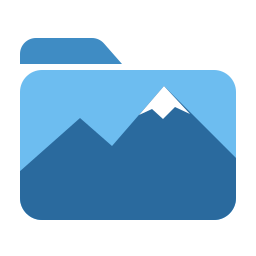
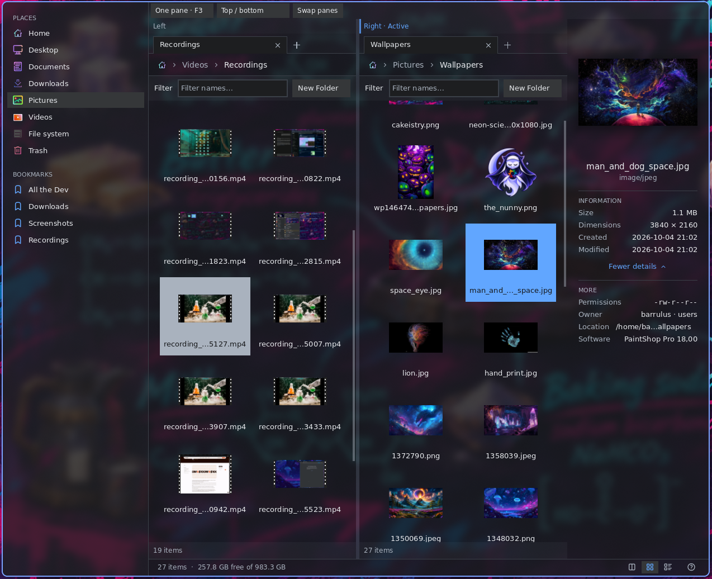
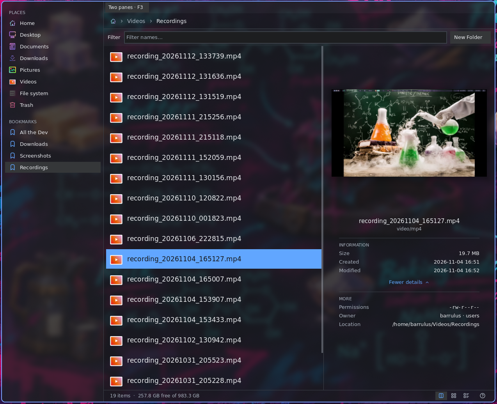
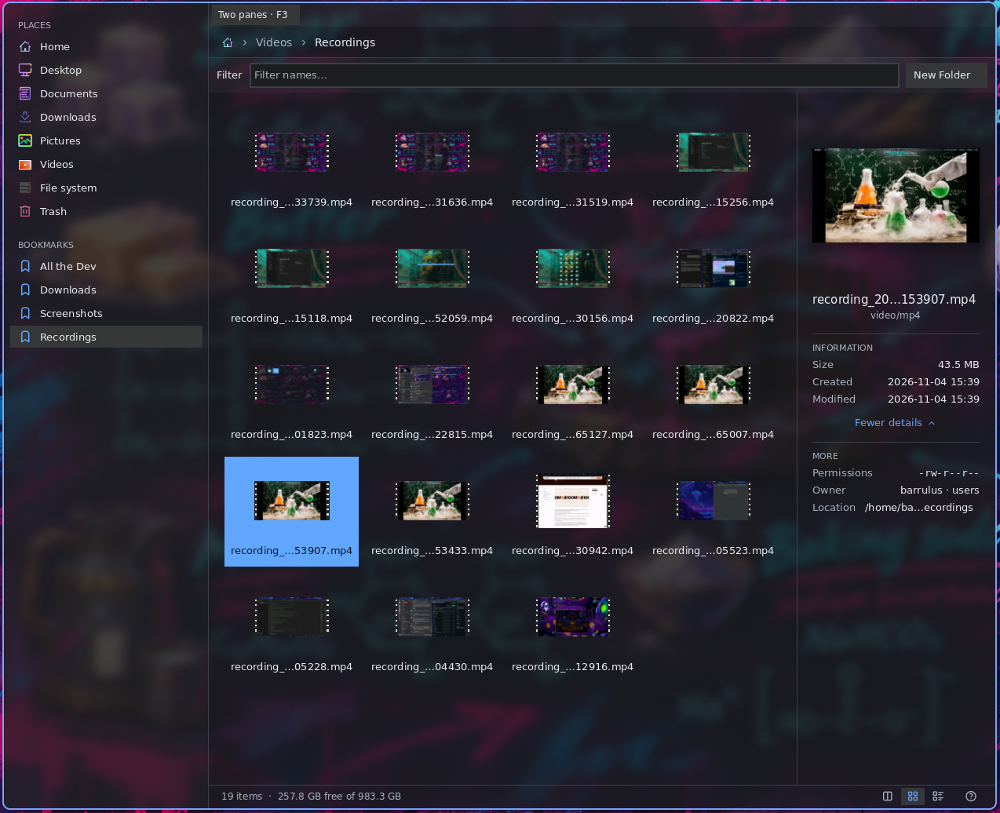

<p align="center"></p>

<h1 align="center">rummage</h1>

<p align="center">
  <b>A native file manager for Wayland.</b><br>
  C++20, Wayland and OpenGL ES. No GTK, Qt or GLib.<br>
  Columns, thumbnails and details, with keyboard navigation and isolated image and text previews.
</p>

<p align="center">
  
  <br>
  <sub>Two panes with independent tabs, video and image thumbnails, and the information pane.</sub>
</p>

| Column view with a video still preview | Video thumbnails in the grid |
| --- | --- |
|  |  |

rummage provides three views of your files, two persistent panes, tabs, recursive
filename search, a command palette, Quick Look, and file operations with conflict handling, trash and undo. It
follows desktop colours and icon themes, with a Noctalia palette integration.

rummage is a fork of [Nordend](https://github.com/pankaspe/nordend-fm), created by
[pankaspe](https://github.com/pankaspe). It retains the upstream MIT license and
copyright. These docs describe this fork's current source; the 0.5.0 version
number alone does not identify its feature set. See [release history](docs/releases.md)
and [upgrading from Nordend](docs/install.md#upgrading-from-nordend).

## Start here

- [Install and build](docs/install.md): requirements, Nix, NixOS, Home Manager, Void and CMake.
- [Use rummage](docs/usage.md): views, navigation, tabs, selection, search and places.
- [Configure rummage](docs/configuration.md): settings, reload behavior and saved state.
- [Use rummage as a file picker](docs/file-picker.md): Open/Save dialogs and portal setup.
- [Troubleshoot](docs/troubleshooting.md): startup, previews, menus and desktop integration.
- [All documentation](docs/README.md): guides, references and development records.

From this checkout, with Nix flakes enabled:

```sh
nix run . -- ~/Pictures
```

Or build with the [required dependencies](docs/install.md#build-dependencies) installed:

```sh
cmake -B build -G Ninja -DCMAKE_BUILD_TYPE=Release
cmake --build build
./build/rummage ~/Pictures
```

Run the GUI in a Linux Wayland session with OpenGL ES 3.0. Start with **Ctrl+1/2/3**
to change views, **Space** for Quick Look, **Ctrl+K** for commands, **Ctrl+F** to find
files, and **F1** for the active shortcuts.

## What it does

| Area | Capabilities |
| --- | --- |
| Browse | Columns, grid, expandable details, dual panes, tabs, filters, sorting and zoom |
| Find | Fuzzy filename/path search under the current folder; command palette with places and tabs |
| Preview | Images including HEIC/HEIF, camera previews, DNG development and text with syntax colours; optional video thumbnails/stills |
| Manage | Copy, move, rename, create, trash, restore, permanent delete, undo/redo and darktable sidecar handling |
| Integrate | Desktop applications, Open With, terminals, bookmarks, removable disks, clipboard and drag and drop |
| Customize | Fonts, icons, colours, transparency, shortcuts, external actions and nested context menus |
| Pick files | Standalone selection commands and an optional XDG FileChooser portal backend |

The [feature overview](docs/features.md) links to the behavior and limitations of each
area. Image and text decoders run in separate preview helpers; see the
[security model](docs/security.md) for the boundaries and exceptions.

Performance results are recorded with their dates, machines and methods in
[benchmarks](docs/benchmarks.md). They are historical measurements, not promises for
every build or desktop.

## Development downloads

<!-- development-downloads:start -->
[Latest development build](https://github.com/barrulus/rummage/releases/tag/development):
unsigned Linux x86_64 snapshots, updated after all checks pass on `main`.

| Distribution | Download |
| --- | --- |
| Debian 13 | [DEB](https://github.com/barrulus/rummage/releases/download/development/rummage-debian13-amd64.deb) |
| Fedora 44 | [RPM](https://github.com/barrulus/rummage/releases/download/development/rummage-fedora44-x86_64.rpm) |
| Arch Linux | [Package](https://github.com/barrulus/rummage/releases/download/development/rummage-arch-x86_64.pkg.tar.zst) |
| openSUSE Tumbleweed | [RPM](https://github.com/barrulus/rummage/releases/download/development/rummage-tumbleweed-x86_64.rpm) |
| Void glibc | [XBPS bundle](https://github.com/barrulus/rummage/releases/download/development/rummage-void-glibc-x86_64.tar.gz) |

Follow the [installation and checksum instructions](https://github.com/barrulus/rummage/blob/main/docs/install.md#development-downloads).
Use the package for your exact distribution. For Nix, use
`nix run github:barrulus/rummage/development`; pin the commit in
[source.json](https://github.com/barrulus/rummage/releases/download/development/source.json)
for a fixed revision. These are individual development packages, not an update repository.
<!-- development-downloads:end -->

## Contribute

See [CONTRIBUTING.md](CONTRIBUTING.md) for the development workflow,
[architecture](docs/architecture.md) for the source map, and the
[roadmap](docs/roadmap.md) for planned work.

## License

[MIT](LICENSE). Bundled code and data are credited in [THIRD_PARTY.md](THIRD_PARTY.md).
