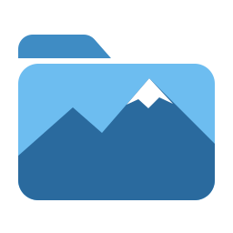
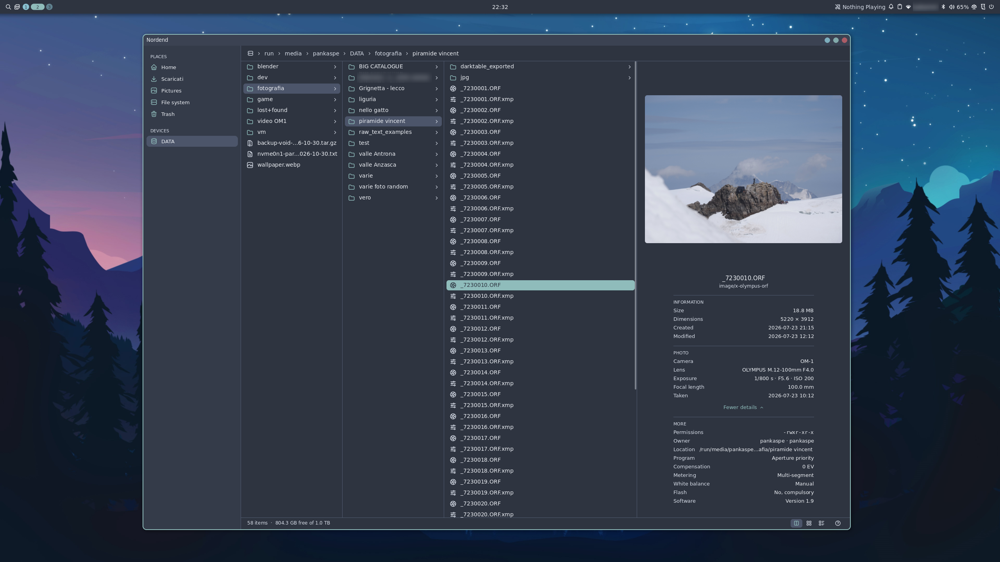
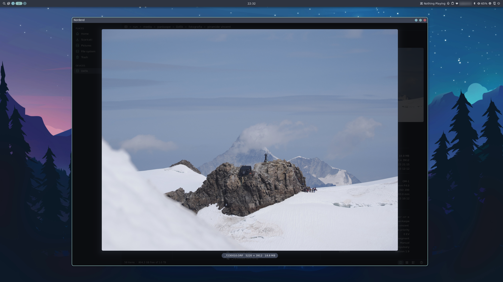

<p align="center"></p>

<h1 align="center">Nordend</h1>

<p align="center">
  <b>A fast, native file manager for Wayland, made for photographers.<br>
  At home on any Wayland desktop, and right at home on <a href="https://github.com/noctalia-dev">Noctalia</a>.</b><br>
  No GTK, no Qt: C++20 straight on Wayland and OpenGL ES.
</p>

<p align="center">
  <a href="https://github.com/pankaspe/nordend-fm/releases/tag/v0.1.0"></a>
  
  
  
  
</p>

> [!NOTE]
> **0.1.0, the first release.** Young software, used every day by its author. To try it,
> [build it from source](#building); it takes about a minute.

<p align="center">
  <a href="https://pankaspe.github.io/nordend-fm/"></a>
</p>

<p align="center">
  
  <br>
  <sub>The column view on a folder of OM System raw files, in the Noctalia theme on Umbriel.</sub>
</p>

<p align="center">
  
  <br>
  <sub>Quick Look (<kbd>Space</kbd>) on the same raw file.</sub>
</p>

## Why Nordend

Nordend talks to the compositor directly, with **no toolkit at all**: text, icons, scrolling and
animations come from its own renderer. It takes your desktop's light or dark style and accent
colour; on Noctalia (Noctalia Shell, the Umbriel compositor) it wears your Noctalia theme, live.

- **Photos first.** Thumbnails, the preview pane and Quick Look read the previews cameras store
  in their raw files, with the shot's EXIF and your darktable rating; darktable sidecars travel
  with their photo through every rename, copy, move and trip to the trash.
- **Three views of the same folder.** Columns, a thumbnail grid and a details table
  (<kbd>Ctrl</kbd>+<kbd>1</kbd> <kbd>2</kbd> <kbd>3</kbd>); switching keeps your place and your
  selection.
- **Small and fast, and measured.** A 3 MB binary, a 10 000-file folder in 0.7 ms, a raw photo
  in Quick Look in under 100 ms, and no CPU at all while nothing moves.
- **Careful with your files.** Nothing overwritten without asking, nothing half-copied under a
  real name, a real freedesktop trash, and <kbd>Ctrl</kbd>+<kbd>Z</kbd>.
- **Keyboard first, mouse always.** Every action has a key (<kbd>F1</kbd> lists them) and a click.

Everything it does, and every shortcut, is in the [guide](https://pankaspe.github.io/nordend-fm/#guide).

## At a glance

| | |
|---|---|
| Binary | **3.54 MB** (2.96 MB stripped), x86-64, decoders built in |
| Libraries | 21 direct; no GTK, no Qt, no GLib |
| Code | about 35 300 lines of C++20, 10 400 of tests (276 test cases, under ASan and TSan too) |
| Memory | **25 MB** of its own at start, **54 MB** after browsing 163 raw photos in every view |
| Idle | **0 CPU**: nothing is drawn while nothing moves |

## Benchmarks

The design's four targets, measured on 2026-11-01 (Ryzen 7 5700G, RX 6650 XT, SATA SSD):

| Target | Measured |
|--------|---------:|
| Cold start to the first frame on screen: < 150 ms | **128 ms** (warm: **64 ms**) |
| A 10 000-file folder: first frame < 50 ms | first entries in **0.7 ms**, all in **17 ms** |
| Quick Look of an ORF raw photo: < 100 ms | **82-96 ms** |
| Scrolling with no dropped frame | worst frame **3.7 ms** of 13.3 (75 Hz) |

More on the [site](https://pankaspe.github.io/nordend-fm/#performance), every method in
[docs/benchmarks.md](docs/benchmarks.md).

## Building

Void Linux package names:

```sh
sudo xbps-install -S cmake ninja pkgconf wayland-devel wayland-protocols \
    libxkbcommon-devel libglvnd-devel MesaLib-devel \
    harfbuzz-devel freetype-devel fontconfig-devel tomlplusplus-devel \
    libwebp-devel libjxl-devel exiv2-devel zlib-devel sdbus-c++-devel
cmake -B build -G Ninja
cmake --build build
./build/nordend            # your home folder, or ./build/nordend ~/Pictures
cmake --install build --prefix ~/.local --strip   # nordend and its desktop entry
```

On Void Linux there is also an xbps-src template in [`packaging/void`](packaging/void).
Needs a Wayland compositor with xdg-shell. Default for folders, configuration, development builds
and tools: [install](https://pankaspe.github.io/nordend-fm/#install),
[configuration](https://pankaspe.github.io/nordend-fm/#configuration).

## What's next

0.1.0 is out, after a week of daily use by the author. Next: **tabs** (<kbd>Ctrl</kbd>+<kbd>T</kbd>).

Then, roughly in this order: a command palette (<kbd>Ctrl</kbd>+<kbd>K</kbd>); a dual pane and
batch renaming; photo culling (ratings and colour
labels in darktable's sidecars, comparison, histogram); scripting in Luau; a file chooser for
other applications; text files in an external editor; translations, Italian first. The full list
is on the [roadmap](https://pankaspe.github.io/nordend-fm/#roadmap).

## Documentation

[The site](https://pankaspe.github.io/nordend-fm/) ·
[Features](docs/features.md) ·
[Devlog](docs/devlog.md) ·
[Benchmarks](docs/benchmarks.md) ·
[Compatibility](docs/compatibility.md) ·
[Upstream bug log](docs/buglog.md)

## Development

Nordend is copiloted by **Claude Opus** (Anthropic), which assists with code writing, code analysis,
bug hunting, testing and documentation. Design decisions, testing on real hardware and every release
are the author's. Step numbers in code comments ("ROADMAP 6.3") refer to the internal roadmap.

## License

[MIT](LICENSE). Third-party code and data (the wuffs decoder, the Tabler icons, Noctalia's default
palette) are listed in [THIRD_PARTY.md](THIRD_PARTY.md).
