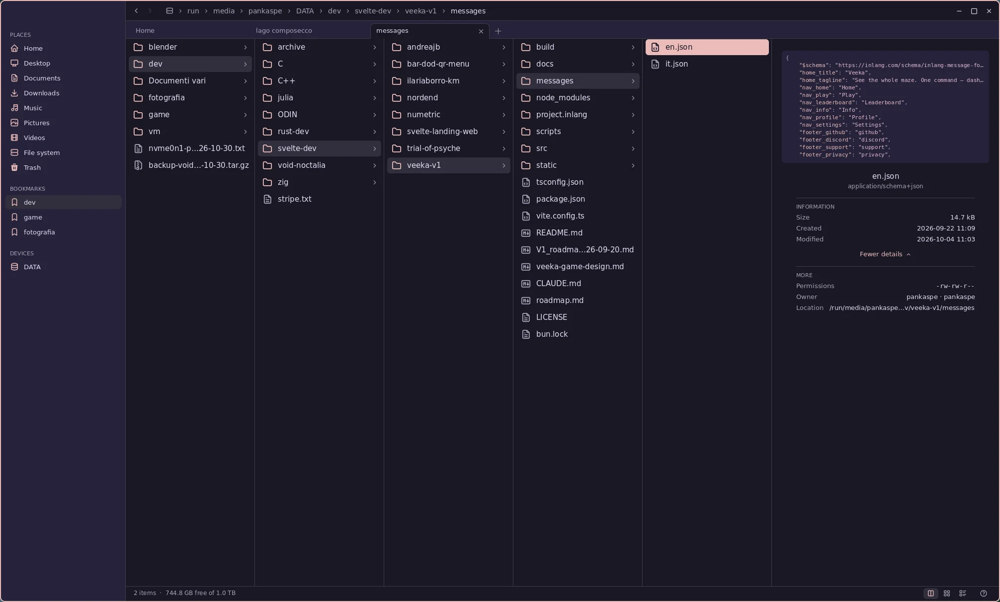

<p align="center"></p>

<h1 align="center">Nordend</h1>

<p align="center">
  <b>A native file manager for Wayland: fast, light and safe.</b><br>
  No GTK, no Qt, no GLib: C++20 straight on Wayland and OpenGL ES.<br>
  At home on any Wayland desktop, and right at home on <a href="https://github.com/noctalia-dev">Noctalia</a>.
</p>

<p align="center">
  <a href="https://github.com/pankaspe/nordend-fm/releases/tag/v0.4.0"></a>
  
  
  
  
</p>

> [!NOTE]
> **Young software, used every day by its author.** 0.4.0 reads pictures with **Nordend's own
> code**: DNG developed when its previews are too small, TIFF, raw previews and EXIF without
> exiv2, each picture made in a **caged helper process**. 0.3.0 brought the command palette
> (<kbd>Ctrl</kbd>+<kbd>K</kbd>) and finding files (<kbd>Ctrl</kbd>+<kbd>F</kbd>).
> On Void Linux, [install it as a package](#on-void-linux); anywhere else,
> [build it from source](#from-source) in about a minute.

<p align="center">
  
  <br>
  <sub>The columns in a folder of photos exported from darktable, two tabs open, the context menu and the info pane with the photo's EXIF.</sub>
</p>

## Why Nordend

Nordend talks to the compositor directly, with **no toolkit at all**: text, icons, scrolling and
animations come from its own renderer. It takes your desktop's light or dark style and accent
colour; on Noctalia (Noctalia Shell, the Umbriel compositor) it wears your Noctalia theme, live.

- **Fast.** The first frame in about 65 ms, a 10 000-file folder in 0.7 ms, a raw photo in
  Quick Look in under 100 ms. Every figure is measured, with the tool to measure it again.
- **Light.** A 3 MB binary, 17 libraries, about 25 MB of memory, and no CPU at all while
  nothing moves.
- **Safe with what it reads.** Files that come from outside are read by `nordend-preview`, a
  small helper process in a cage of Nordend's own (seccomp and landlock: no files, no network,
  no programs). A broken or hostile file costs at most its preview; Nordend carries on.
- **Its own readers.** TIFF (LZW, Deflate, PackBits, JPEG, tiles, BigTIFF), PGM and PPM are
  read by code written for Nordend, checked pixel for pixel against libtiff and fuzzed; PNG, JPEG
  and GIF by [wuffs](https://github.com/google/wuffs), memory-safe by construction. Raw files
  show the JPEG their camera stored, so the camera's own rendering; a DNG whose stored previews
  are too small is developed by Nordend's own reader, with the file's own colour.
- **Photos and their editors.** Thumbnails, the info pane and Quick Look with the shot's EXIF
  and rating; darktable sidecars travel with their photo through every rename, copy, move and
  trip to the trash.
- **Three views of the same folder.** Columns, a thumbnail grid and a details table
  (<kbd>Ctrl</kbd>+<kbd>1</kbd> <kbd>2</kbd> <kbd>3</kbd>); switching keeps your place and your
  selection. Sort by name, size, date or type from the context menu, in every view.
- **Tabs.** <kbd>Ctrl</kbd>+<kbd>T</kbd>, or a middle click on a folder to open it behind the
  one you are in; each tab keeps its folder, view and history, and they all come back at the next
  start.
- **Careful with your files.** Nothing overwritten without asking, nothing half-copied under a
  real name, a real freedesktop trash, and <kbd>Ctrl</kbd>+<kbd>Z</kbd>.
- **Keyboard first, mouse always.** Every action has a key (<kbd>F1</kbd> lists them) and a click.

Everything it does is in [docs/features.md](docs/features.md); inside Nordend, <kbd>F1</kbd> lists
every shortcut.

## Features

- **Views:** columns, thumbnail grid, details table; tabs; zoom; sort by name, size, date or type
- **Quick Look** (<kbd>Space</kbd>): photos fill the window, raw files included; text files on a
  scrollable page; the arrows walk the folder
- **Raw files:** the previews cameras embed in ORF, CR2, NEF, ARW, RAF, RW2, SRW, DNG, 3FR
  (found by Nordend's own reader), upright and cropped to the shot; DNGs with only a small
  preview (Leica, drones) developed by Nordend itself; EXIF in the info pane
- **Images:** PNG, JPEG, GIF (wuffs), WebP, JPEG XL, and TIFF, PGM and PPM with Nordend's own
  readers; thumbnails in the shared freedesktop cache
- **Isolated reading:** every picture is made in a caged helper process, never in Nordend
- **darktable:** sidecars follow their photo everywhere; ratings shown
- **Command palette** (<kbd>Ctrl</kbd>+<kbd>K</kbd>): every command, place and tab, fuzzy-matched
  (fzy), the recently used first
- **Find files** (<kbd>Ctrl</kbd>+<kbd>F</kbd>): fuzzy search of every file under the folder,
  first results in milliseconds even among 270 000; Enter shows it, Space opens Quick Look
- **Files:** copy and move with progress and conflict questions, rename, new folder or file
  from templates, undo and redo, freedesktop trash with restore, delete permanently
- **Drag and drop** within Nordend and with other apps; rubber-band selection; the system
  clipboard
- **Sidebar:** places, GTK bookmarks, disks through udisks2 (mount, unmount, eject)
- **Opening:** default applications and "Open With", resolved exactly as GLib does; a terminal
  in any folder (<kbd>F4</kbd>)
- **Always current:** folders follow changes on disk (inotify); history with
  <kbd>Alt</kbd>+<kbd>←</kbd> <kbd>→</kbd> and the mouse's side buttons
- **Looks:** Noctalia's theme live, or the desktop's light/dark style and accent (GNOME, Plasma);
  its icon follows the accent; fractional scaling; its own title bar where needed
- **Remembers** views, order, tabs and window size; a short `config.toml`, reloaded live

## At a glance

| | |
|---|---|
| Binary | **3.85 MB** (3.20 MB stripped), x86-64; the decoders in `nordend-preview`, 0.97 MB (0.87 stripped), a separate caged helper |
| Libraries | 17 direct (the helper: 8); no GTK, no Qt, no GLib |
| Code | about 46 600 lines of C++20, 15 700 of tests (355 test cases, under ASan and TSan too) |
| Memory | **25 MB** of its own at start; pictures are decoded in the helpers, which give their memory back after a quiet second |
| Idle | **0 CPU**: nothing is drawn while nothing moves |

## Benchmarks

The design's four targets, measured on 2026-11-01 (Ryzen 7 5700G, RX 6650 XT, SATA SSD):

| Target | Measured |
|--------|---------:|
| Cold start to the first frame on screen: < 150 ms | **128 ms** (warm: **64 ms**) |
| A 10 000-file folder: first frame < 50 ms | first entries in **0.7 ms**, all in **17 ms** |
| Quick Look of an ORF raw photo: < 100 ms | **82-96 ms** |
| Scrolling with no dropped frame | worst frame **3.7 ms** of 13.3 (75 Hz) |

Every measurement and its method is in [docs/benchmarks.md](docs/benchmarks.md).

## Install

Nordend needs Linux with a Wayland compositor that offers xdg-shell (developed on Umbriel, also
tried on GNOME, Plasma and niri) and a GPU driver with OpenGL ES 3.0 (Mesa).

### On Void Linux

Nordend is developed on Void, and comes with an xbps-src template in
[`packaging/void`](packaging/void). It builds the latest release into a package that puts
`nordend`, its desktop entry and its icon under `/usr`:

```sh
# 1. void-packages, once (skip if you already have a checkout)
git clone --depth 1 https://github.com/void-linux/void-packages
cd void-packages
./xbps-src binary-bootstrap

# 2. Nordend's template, then the package
git clone --depth 1 https://github.com/pankaspe/nordend-fm /tmp/nordend-fm
cp -r /tmp/nordend-fm/packaging/void/nordend srcpkgs/
./xbps-src pkg nordend
sudo xbps-install -R hostdir/binpkgs nordend
```

The package is the latest release, **0.4.0**. What `main` gains after it comes with the next
release; to have it at once, build from source.

### From source

On Void Linux the packages are these; elsewhere, the development packages of the same libraries
(their names differ and have not been tried yet):

```sh
sudo xbps-install -S cmake ninja pkgconf wayland-devel wayland-protocols \
    libxkbcommon-devel libglvnd-devel MesaLib-devel \
    harfbuzz-devel freetype-devel fontconfig-devel tomlplusplus-devel \
    libwebp-devel libjxl-devel zlib-devel sdbus-c++-devel
git clone https://github.com/pankaspe/nordend-fm
cd nordend-fm
cmake -B build -G Ninja
cmake --build build
./build/nordend            # your home folder, or ./build/nordend ~/Pictures
cmake --install build --prefix ~/.local --strip   # nordend, its desktop entry and icon
```

### Then

Make it the default for folders (a browser's "Show in folder", `xdg-open`) and give it a key:

```sh
xdg-mime default nordend.desktop inode/directory
```

```toml
# Umbriel's config.toml; other compositors have their own way
"Mod+E" = { action = "spawn nordend", repeat = false }
```

Configuration: every key, with its default, in [docs/config.example.toml](docs/config.example.toml)
(copy it to `~/.config/nordend/config.toml`; `nordend --check-config` reports any problem). The
command line: `nordend [DIR]`, `--config FILE`, `--version`, and `--about` (what Nordend runs on,
for a bug report).

## Versions

Nordend stays at 0.x while it is young. A new **minor** version (0.2.0, 0.3.0…) brings features
you can see; a **patch** (0.2.1) only fixes things. 1.0.0 will come once Nordend has been its
author's everyday file manager for a while and its files (`config.toml`, `state.toml`) have
settled.

| Version | What it brought |
|---|---|
| on `main`, next | — |
| [0.4.0](https://github.com/pankaspe/nordend-fm/releases/tag/v0.4.0), 2026-11-08 | Image previews read by Nordend's own code: DNG developed when its previews are too small (Leica M240 and M8, DJI drones, Adobe-converted files) with the file's colour, tone curve, vignetting and lens corrections, read identically to LibRaw and 2-4 times faster; TIFF with its own reader (BigTIFF, LZW, Deflate, PackBits, JPEG, 8/16-bit and float, CMYK, tiles, a scanner's scan in a SubIFD); raw files' previews and the info pane's EXIF without exiv2 (the same results, 3 to 100 times quicker); pictures made in small `nordend-preview` processes, each in a cage of Nordend's own (seccomp and landlock), so a file that crashes or hangs one costs only its preview; one path for every picture, told by the file's bytes; a plain sentence when a file cannot be shown. Canon CRW and Minolta MRW get that sentence; darktable sidecars' ratings are no longer read (Nordend's own ratings come next) |
| [0.3.1](https://github.com/pankaspe/nordend-fm/releases/tag/v0.3.1), 2026-11-07 | Fixes: DNG previews stored as a JPEG inside a TIFF (Leica M240, Samsung GX20 at full size), broken previews passed over for the next one (Samsung SRW), PGM and PPM images, a plain message for raw formats with no readable preview (Sigma X3F, old Panasonic RAW) |
| [0.3.0](https://github.com/pankaspe/nordend-fm/releases/tag/v0.3.0), 2026-11-06 | The command palette (<kbd>Ctrl</kbd>+<kbd>K</kbd>, fuzzy matching with fzy); finding files under a folder (<kbd>Ctrl</kbd>+<kbd>F</kbd>); Nordend's icon follows the desktop's accent colour (`icon.follow_accent`) |
| [0.2.0](https://github.com/pankaspe/nordend-fm/releases/tag/v0.2.0), 2026-11-06 | Sort By in the context menu; tabs (a folder, a view, a history and a zoom each, remembered); zoom in the columns and the details |
| [0.1.0](https://github.com/pankaspe/nordend-fm/releases/tag/v0.1.0), 2026-11-06 | The first release: three views, raw previews and Quick Look, file operations with undo, trash, drag and drop, disks, the desktop's look |

## What's next

Nordend stays what it is: a native C++ file manager, made for Noctalia Shell, with no GTK or Qt;
very light, safe and fast. Everything else is a feature on top, added only when it keeps those
three.

0.1.0 came out after a week of daily use by the author; 0.2.0 added Sort By, tabs and zoom in the
lists; 0.3.0 the command palette (<kbd>Ctrl</kbd>+<kbd>K</kbd>) and finding files
(<kbd>Ctrl</kbd>+<kbd>F</kbd>); 0.3.1 more raw previews; 0.4.0 image previews read by Nordend's own
code in caged helpers. Coming, roughly in this order: **previews, one family at a time**: text
next (syntax highlighting, selecting and copying), then other common formats one by one (SVG,
AVIF, fonts, archive contents, audio tags).
After that: colour labels and star ratings of your own, not tied to any raw editor; a Quick Look
for photographers (100 % zoom, EXIF, histogram, comparison); a dual pane, a queue of operations
and batch renaming; translations, a file chooser for other applications, plugins in Luau (one
system, each plugin caged; heavy formats such as PDF and video, and local AI search, as separate
engines).

## Documentation

[Features](docs/features.md) ·
[Devlog](docs/devlog.md) ·
[Benchmarks](docs/benchmarks.md) ·
[Compatibility](docs/compatibility.md) ·
[Upstream bug log](docs/buglog.md)

## Development

Nordend is copiloted by **Claude Opus** (Anthropic), which assists with code writing, code analysis,
bug hunting, testing and documentation. Design decisions, testing on real hardware and every release
are the author's. Step numbers in code comments ("ROADMAP 6.3") refer to the internal roadmap.

## License

[MIT](LICENSE). Third-party code and data (the wuffs decoder, the Tabler icons, Noctalia's default
palette) are listed in [THIRD_PARTY.md](THIRD_PARTY.md).
