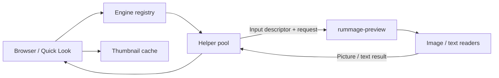

# Architecture

[Documentation](README.md) · [Development](development.md) · [Security](security.md)

rummage is a Linux C++20 application with a native Wayland/OpenGL ES UI. It uses
system libraries for text shaping, graphics, configuration and selected codecs,
without a GTK/Qt/GLib application layer. Public headers live in each module's
`include/rummage/…`; implementation lives under `src/` within that module. CMake
aliases follow the `rummage::` namespace.

## Source map

| Directory | Responsibility |
| --- | --- |
| `src/app` | CLI, service setup, browser/picker assembly and event-loop lifetime |
| `src/core` | Event loop, workers, logging, file watchers, settings, action/menu definitions and picker messages |
| `src/ui` | Wayland objects, EGL/GLES rendering, fonts/text, icons, input, clipboard and generic widgets |
| `src/theme` | Palette parsing, desktop colours, syntax colours and accent application icon |
| `src/fs` | Directory models/watchers, MIME, sort/selection, search, places, transfers, trash and undo |
| `src/views` | Browser, columns/grid/details, sidebar, tabs, palettes, menus, dialogs, Quick Look and picker UI |
| `src/platform` | D-Bus, desktop entries/app associations, launching, archives, notifications, devices and portal backend |
| `src/engines` | Manifest parsing, program discovery and MIME-family routing |
| `src/picture` | Image types, geometry/scaling, cache image support and loader interface |
| `src/text` | Text representation, loading interface, selection and syntax support |
| `src/formats` | Actual file readers linked into the helper; image and text families |
| `src/isolate` | Helper startup/pooling, descriptor protocol, resource limits and sandbox |
| `src/thumbs` | Shared thumbnail cache |
| `src/media` | Optional isolated FFmpeg video engine |
| `src/pdf` | Optional isolated MuPDF PDF engine |
| `src/svg` | FreeType-based SVG icon rendering |
| `src/tools` | Developer renderers, inspectors and benchmarks |
| `tests` | Doctest suite, standalone integrations, fixtures and fuzz targets |
| `data`, `nix`, `packaging` | Desktop/portal/theme assets and packaging |

## UI, I/O and state

`src/app/main.cpp` constructs the event loop, workers, display, renderer, fonts,
theme and application services. A browser window owns the navigation/view state
and connects commands to platform/filesystem services. Picker mode reuses the
browser with selection constraints and its own accept/cancel controls.

The window thread processes Wayland/input events and drawing. Directory scans,
MIME work, thumbnail loads and filesystem work use background execution so they
do not block interaction. Directory models accept incremental results and watch
changes with inotify. Transfers report progress and conflicts back to the UI.
Rendering is requested on changes and animation frames rather than a permanent
idle redraw loop.

Views share filesystem models and browser commands. Two tab groups hold separate
location/view/sort/hidden/filter state; sidebar, information pane and undo serve
the window. The browser owns split orientation, divider and active-pane state.
`views::StateKeeper` writes remembered state. Config and palette watchers reload
supported settings; font construction is a startup operation.

## Preview engines

The application selects a family from engine manifests. Its picture/text loader
interfaces submit work to the helper pool. The parent opens the input file and
passes a descriptor over a Unix socket; the helper decodes through `src/formats`
and returns validated picture/text results. Bulk image output uses shared file
descriptors/mappings rather than serializing pixels through UI objects.

`data/engines/base.toml` describes the shipped engine. In a build tree, manifests
live in `engines/` beside the executable and helpers beside it. Installed layouts
use `../share/rummage/engines/` and `../libexec/rummage/`. Discovery is relative to
the executable; a missing manifest directory is not replaced by an arbitrary
system-wide plugin search. `RUMMAGE_ENGINE_PATH` adds explicit trusted absolute
manifest directories (colon-separated), with helpers located under the matching
prefix’s `libexec/rummage`. The optional Nix media package configures this path.

| Manifest field | Contract |
| --- | --- |
| `engine.name` | Engine identifier |
| `engine.program` | Plain executable filename, resolved in the helper locations |
| `engine.protocol` | Must match the current protocol version (4) |
| `family.name` | Reader-family identifier |
| `family.shows` | `picture` or `text` |
| `family.info`, `family.thumbnails` | Advertised capabilities |
| `family.mime` | Types handled by this family |
| `family.subclasses` | Also match MIME subtypes when true |

Invalid manifests, incompatible protocols or missing programs are skipped with
diagnostics. Manifests load in name order; already-owned types stay with the earlier
registration. `--about` lists discovered engines. See
[engines.hpp](../src/engines/include/rummage/engines/engines.hpp) and
[protocol.hpp](../src/isolate/src/protocol.hpp) for exact contracts.

Adding a manifest alone does not implement decoding: its program must speak the
protocol and satisfy isolation/validation expectations. This is an internal
extension mechanism, not a stable third-party plugin ABI. Decoders must remain
out of the main application's format-reader dependency graph. The optional `rummage-media` uses the same isolation protocol and links FFmpeg
libraries only in that helper; the optional `rummage-pdf` does the same with MuPDF. SVG theme icons and thumbnail cache parsing have
different boundaries; see
[security](security.md).

## Commands, actions and menus

Built-in keyboard commands originate in `views/shortcuts.cpp`; browser command
dispatch and palette/menu construction route to shared behavior. Configurable
actions are parsed/validated in `core/actions.cpp`, then matched against a captured
selection and MIME context. `platform/action_handoff.cpp` handles launching and
destination selection; notifications track the launched process's exit.

Menu layouts are a separate tree of IDs, groups, separators and a remaining-items
placeholder. They arrange available commands without changing applicability or
palette/shortcut access. Reload validates actions, menus and shortcuts together,
preserving the prior valid set on failure. Built-in archive workflows have their
own backend selection and completion handling in `platform/archives.cpp`.

## File-chooser portal

The installed D-Bus service activates `rummage --portal`. The backend handles
OpenFile, SaveFile and SaveFiles, translates requests to picker messages and
starts picker children. Results return as file URIs; cancellation and child failure
are handled per request. The backend can serve concurrent requests and exits after
30 seconds idle or when its D-Bus connection is lost. Cancellation allows three
seconds for the child to flush its UI state before forced termination.

The picker UI reuses views/previews while excluding external actions and avoiding
writes to the file manager's state. Its own view, window size and last folder are
saved separately in `picker.toml`. Wayland parenting uses xdg-foreign-v2 and optional modal
hints. Portal selection is desktop configuration, independent of the default
`inode/directory` application. See [file-picker setup](file-picker.md) and its
integration tests for observable behavior.

## Change entry points

For a new setting, update `core/config`, validation tests and the example/reference.
For a file operation, inspect `fs`, browser dispatch and undo/conflict tests together.
For a view interaction, check all three views, shortcuts and picker constraints.
For a format, update readers, engine MIME registration, bounded failure handling,
helper tests and preview documentation. Dependency/installation changes must be
reflected in CMake, applicable packaging and the installation guide.
